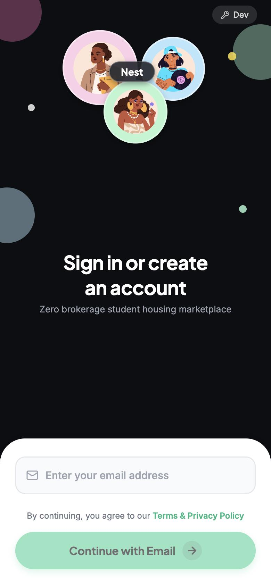
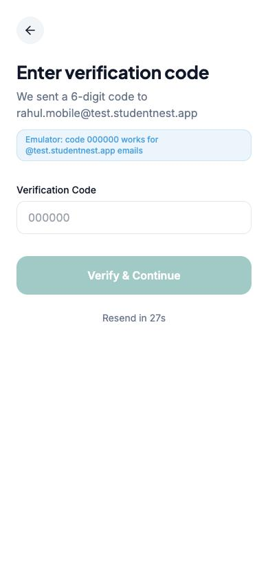
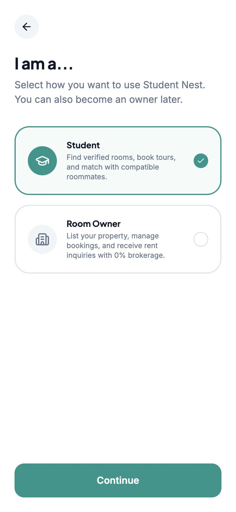
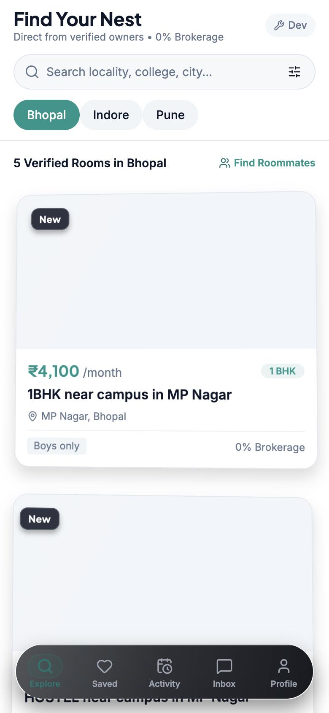
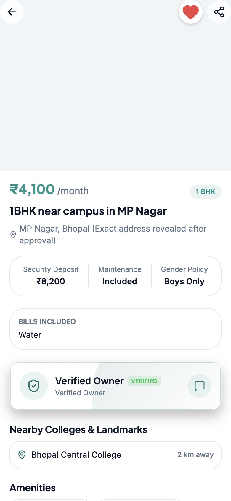
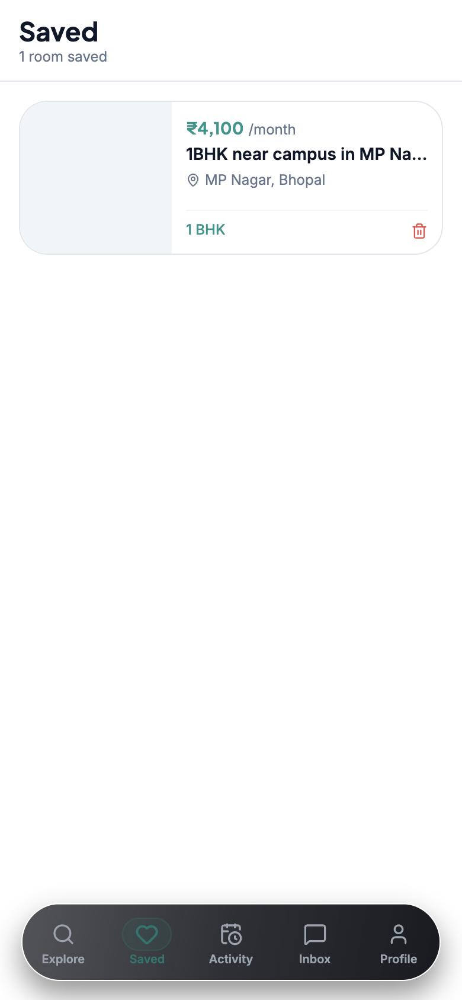
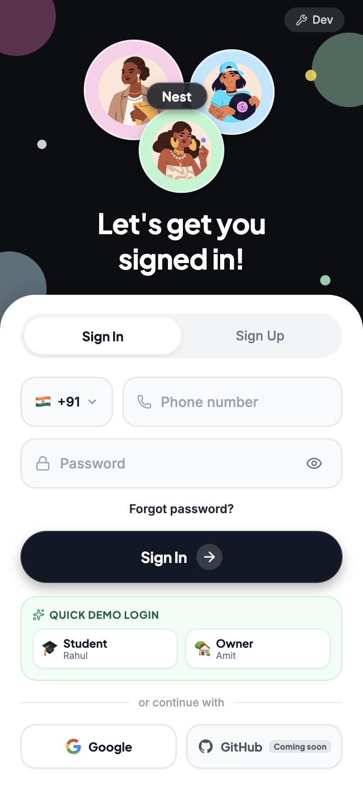
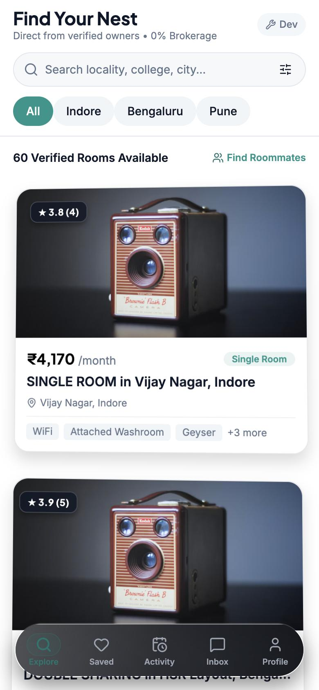

# Student Nest mobile

**Live demo:** web version at https://student-nest-mobile.expo.app, backed by the live API at https://student-nest-api-epba.onrender.com (free tier, so the first request after about 15 idle minutes can take up to a minute). Android APK (install on an Android phone; allow installs from your browser when asked): https://expo.dev/accounts/ronakkumarsinghs/projects/student-nest-mobile/builds/e61a2ee6-90b9-4ac6-af2b-b006d09f5737. It's built with `eas build --platform android --profile preview`, and was not tested on a device before publishing.

The Expo app for Student Nest, a marketplace where students in Indian cities find rooms and PGs near their college and deal with the owner directly, with no broker. Students sign in with an email code, search rooms by city, open a listing, save it and apply to book. Owners see their own listings.

It talks to the NestJS API in [`student-nest-backend`](https://github.com/ronak-kumar-sing/student-nest-backend). Every feature can also run on an in-memory mock backend, so the UI can be worked on without the API.

## Stack

- Expo SDK 58, React Native 0.88, React 19.3, TypeScript (strict)
- Expo Router (file-based routes, typed)
- NativeWind 4 (Tailwind classes) with design tokens in `src/theme`
- TanStack Query for server state, Zustand + MMKV for local state
- Firebase JS SDK (Auth only) for sign-in with the API's custom tokens
- API types generated from the backend's OpenAPI file with `openapi-typescript`
- Jest (`jest-expo`) and Testing Library

## What talks to the real API

| Area | Screens | API calls |
| --- | --- | --- |
| Sign-in and sign-up | email, code, role, profile setup | `POST /v1/auth/otp/email/send`, `POST /v1/auth/otp/email/verify`, `POST /v1/auth/signup`, `GET/PATCH /v1/users/me` |
| Search | Explore tab, city chips | `GET /v1/search/cities`, `GET /v1/search/rooms` |
| Room detail | `property/[id]`, save, apply to book | `GET /v1/properties/:id`, `PUT/DELETE /v1/favorites/:id`, `POST /v1/bookings` |
| Saved rooms | Saved tab | `GET /v1/favorites`, `DELETE /v1/favorites/:id` |
| Applications | Activity tab (bookings), `booking/[id]` | `GET /v1/bookings`, `GET /v1/bookings/:id`, `POST /v1/bookings/:id/actions` |
| Owner listings | Owner Listings tab | `GET /v1/properties/mine` |

Still on mock data: chat and both inboxes, tours, the owner dashboard and requests, the create-listing wizard, and phone verification. Each of those routes says so in a comment, and [`docs/mobile-plan.md`](docs/mobile-plan.md) tracks them.

## Local setup against the real API

The app runs fully on the in-memory mock backend by default (`EXPO_PUBLIC_API_MODE=mock`). To use the local NestJS API instead:

1. Start the backend (`student-nest-backend`) on `http://localhost:3000` with the Firebase emulators (Auth `9099`, Firestore `8080`, Storage `9199`, project `student-nest-dev`) and seeded data. Run it with `DEV_OTP_BYPASS=true` so the fixed dev code works.
2. Create your env file from the example (`.env` is gitignored; never commit it):

   ```bash
   cp .env.example .env
   ```

   It sets `EXPO_PUBLIC_API_MODE=http`, `EXPO_PUBLIC_API_URL=http://localhost:3000`, `EXPO_PUBLIC_FIREBASE_AUTH_EMULATOR_HOST=localhost:9099`, `EXPO_PUBLIC_FIREBASE_PROJECT_ID=student-nest-dev` and a placeholder `EXPO_PUBLIC_FIREBASE_API_KEY` (any non-empty string works against the emulator). On the Android emulator use `10.0.2.2` instead of `localhost` for both the API URL and the Auth emulator host.
3. Start the app with `npx expo start` (restart Metro after changing `.env`).
4. Sign in with email OTP: any email ending in `@test.studentnest.app` accepts the code `000000` (emulator + `DEV_OTP_BYPASS=true` only). A new email goes through role selection and profile setup.
5. Search is public, but the API requires a city (or `near`): for example `GET /v1/search/rooms?city=indore`. The seeded cities are `bhopal`, `indore` and `pune`.

Notes:

- Per-feature transport can be switched at runtime from the dev menu (`/dev`).
- Booking applications need a verified phone (`PHONE_REQUIRED`). Phone verification is not available on the Firebase JS SDK path yet, so a fresh `@test.studentnest.app` user gets that error when applying.
- After the backend contract changes, copy `docs/api/openapi.mobile.json` from the backend repo and run `npm run gen:api` to regenerate `src/api/generated/schema.ts`.
- Checks: `npx tsc --noEmit`, `npx expo lint`, `npx jest --ci`.

## Scripts

| Script | What it does |
| --- | --- |
| `npx expo start` | Start Metro (press `i` for the iOS simulator, `a` for Android, `w` for web) |
| `npm test` | Jest unit and screen tests |
| `npm run typecheck` | `tsc --noEmit` |
| `npm run lint` | `expo lint` |
| `npm run gen:api` | Regenerate `src/api/generated/schema.ts` from `docs/api/openapi.mobile.json` |
| `npm run sync:api` | Copy the OpenAPI file from `../student-nest-backend` |
| `npm run doctor` | `expo-doctor` |

## Screenshots

Taken from the Expo web build (390 px wide) against the local API and emulators with seeded data. The seed does not upload photos, so listing images are empty. These are not simulator screenshots: no iOS runtime was installed on the machine used.

| Sign in | Code | Role |
| --- | --- | --- |
|  |  |  |

| Explore | Room detail | Saved |
| --- | --- | --- |
|  |  |  |

Before this refinement the sign-in screen asked for a phone number and password and showed Google and GitHub buttons, none of which the backend supports, and every list came from mock data:

| Before: sign in | Before: explore (mock data) |
| --- | --- |
|  |  |

## Known limitations

- Applying to book needs a verified phone, and phone verification is not built yet (it needs native Firebase Phone Auth), so new test accounts get `PHONE_REQUIRED`.
- On the web build, `/profile` and `/inbox` exist in both the student and owner route groups, so those two web URLs are ambiguous. Native tab navigation is not affected.
- Dark mode follows the system theme on iOS and Android. It has not been checked on a device or simulator yet.
- Listing photos come from the Storage emulator at `localhost:9199`; the Android emulator cannot reach `localhost` without `10.0.2.2`.

An interview and architecture guide is in [`docs/INTERVIEW.md`](docs/INTERVIEW.md).
