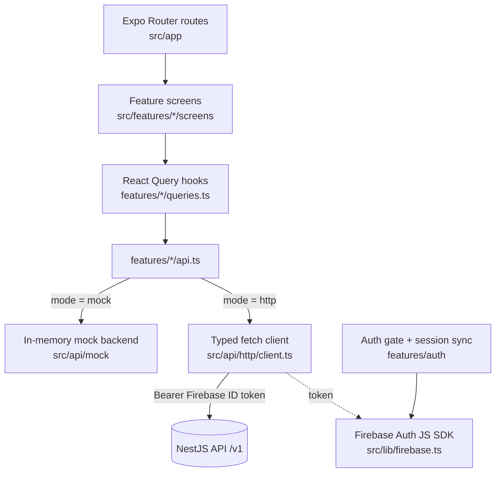

# Student Nest mobile: interview guide

Plain-English notes for explaining the Expo app. Facts were checked on 2026-11-27. The API is explained in depth in `student-nest-backend/docs/INTERVIEW.md`.

## 30-second version

This is the React Native app for Student Nest, a broker-free room marketplace for students, built with Expo SDK 58 and Expo Router. Students sign in with an emailed code, browse rooms by city, open a room, save it and apply to book. Owners see their listings. Each feature has two interchangeable data sources, an in-memory mock backend and the real NestJS API, chosen by an environment variable. That's how the UI was built before the API existed and then switched over one feature at a time.

## 2-minute version

The app is split into `src/app` (thin route files for Expo Router) and `src/features/<feature>` (screens, React Query hooks, mappers and an `api.ts`). Each `api.ts` has a mock and an http implementation with the same interface, and `src/api/mode.ts` picks one per feature from `EXPO_PUBLIC_API_MODE` or the dev menu. The http side uses a small typed `fetch` client. Its types are generated from the backend's OpenAPI file, so if the API renames a field, type-checking fails.

Sign-in uses the Firebase JS SDK, not the native Firebase modules, so the app runs in Expo Go and on simulators without a native rebuild. The API emails a code, returns a Firebase custom token, and the app signs in with it. A session store listens to Firebase and routes the user to sign-up, the student tabs or the owner tabs.

The screens handle loading (skeletons), empty and error states, use pull-to-refresh, and use FlashList for long lists. Saving a room is optimistic: the heart fills at once and rolls back if the server refuses.

The real API returns different shapes from the old mocks (room types, gender policy, amenities, city slugs), so mappers in each feature turn API data into the view models the screens already used. Screens changed very little.

## Problem and users

Students aged 18–24 looking for a room or PG near their college, mostly on phones and sometimes on weak networks. Owners managing listings and applications.

## Architecture

## One request, screen to database and back: saving a room

1. **Tap.** On `property/[id]` the user taps the heart. `useToggleFavoriteMutation` in `src/features/favorites/queries.ts` updates the cached list straight away.
2. **API call.** `src/features/favorites/api.ts` (http mode) calls `http.put('/v1/favorites/:id')`. `src/api/http/client.ts` gets the ID token from Firebase and sends `Authorization: Bearer …`. If the API answers 401, it forces one token refresh and retries.
3. **Backend.** Guards verify the token and the student role. `FavoritesService.add` runs a Firestore transaction on `users/{uid}/favorites/{id}` and bumps a sharded counter.
4. **Back on the phone.** On success, the optimistic state stays and the Saved tab reflects it. On an error, the cache rolls back and a toast shows the message mapped from `error.code` in `src/api/errors.ts`.

## Why each main technology, and one alternative

| Choice | Why | Alternative |
| --- | --- | --- |
| Expo SDK 58 + Expo Router | File-based routes, typed links, one codebase for iOS, Android and web, EAS builds | Bare React Native + React Navigation: more native control, more setup |
| TanStack Query | Caching, retries, infinite lists, optimistic updates | Redux Toolkit Query: heavier, more boilerplate |
| Zustand + MMKV | Small stores for session and filters, persisted with very fast storage | Redux, or AsyncStorage (slower) |
| Firebase JS SDK (Auth only) | Works in Expo Go, no native rebuild | `@react-native-firebase`: needed for phone auth and push, requires dev builds |
| NativeWind | Tailwind classes with light and dark tokens | StyleSheet only: more verbose, no shared tokens with the web app |
| FlashList | Recycled list cells, so long lists stay smooth | FlatList: fine for short lists |
| openapi-typescript | Types follow the API contract | Hand-written types |

## Hard problems solved

- **Mock-to-real migration without rewriting screens.** A per-feature transport switch plus mappers from API data to view models. The mocks used `single_room` and `male`; the API uses `1rk` and `male_only`.
- **Signup routing.** The API answers `403 PROFILE_REQUIRED` for a signed-in user without a profile. The session sync now treats that as "needs signup". Before, only a 404 was handled.
- **Invisible prices.** `cn()` uses tailwind-merge, which didn't know the custom `text-h3` size. It treated it as a colour and dropped `text-primary`, so every price rendered black, and in dark mode almost invisible. Fixed by teaching tailwind-merge the custom sizes, with a regression test.
- **Missing padding.** On web, `SafeAreaView` writes its own inline padding, wiping `p-6`, so the sign-in screens touched the screen edges. The padding moved to an inner `View`.
- **Invalid nested buttons.** The remove button sat inside the saved-room card's link. It now sits next to it, which is also better for screen readers.
- **Removed fake features.** The old sign-in screen showed phone + password, "Forgot password" and Google/GitHub buttons. The backend supports none of them, so they were removed.

## 15 likely interview questions

1. **Why a mock backend?** The UI could be built and tested before the API existed, and the app still runs offline from the API for demos and tests.
2. **How does the app pick mock or real data?** `EXPO_PUBLIC_API_MODE`, with per-feature overrides from the dev menu, read by `src/api/mode.ts`.
3. **Why the Firebase JS SDK instead of the native one?** It runs in Expo Go without a native build. The cost: no native phone auth or push yet.
4. **Where is the token kept?** The Firebase SDK persists the session with AsyncStorage, and the client asks Firebase for a fresh ID token on each request.
5. **How do you handle an expired token?** On a 401, refresh once with `getIdToken(true)` and retry.
6. **What is an optimistic update?** Update the cache first, keep a snapshot, and restore it if the request fails.
7. **How do you keep long lists fast?** FlashList with stable keys, and images through `expo-image` with memory and disk caching.
8. **How do loading, empty and error states work?** Skeletons on first load, a single-action empty state, and an error state with a retry button. Each wired screen has all three.
9. **How does dark mode work?** Colours are CSS-variable tokens with light and dark values. JS-only colours (icons, card surfaces) come from `useThemeColors()`. On iOS and Android it follows the system setting.
10. **How does routing decide which tabs to show?** The auth gate reads session status and role: signed out goes to `(auth)`, unfinished signup goes to role setup, students go to `(student)`, owners to `(owner)`.
11. **How do you keep API types in sync?** `npm run sync:api` copies the backend's OpenAPI file and regenerates `src/api/generated/schema.ts`.
12. **How do you test?** Jest with jest-expo:
    - the http client (token, error envelope, network errors);
    - transport selection;
    - mappers;
    - auth routing;
    - the `cn` helper;
    - a Saved screen state test.
    73 tests.
13. **Android emulator gotcha?** `localhost` is the emulator itself, so use `10.0.2.2` for the API and the Auth emulator.
14. **Why can't a new user book yet?** The API needs a verified phone, and phone auth needs the native Firebase SDK and a dev build.
15. **What would you do next?** Native Firebase for phone auth and push, wire chat and tours to the API, add Maestro end-to-end flows, and test on real devices.

## Current limits

- Only checked through Expo's web target (390 px wide) and an iOS bundle export. No iOS Simulator runtime was installed, and no Android emulator, so it hasn't been run on a simulator or device.
- Dark mode was not checked on a device.
- Chat, tours, inboxes, the owner dashboard and requests, the create-listing wizard, and phone verification still run on mock data.
- On the web target, `/profile` and `/inbox` exist in both the student and owner route groups, so those URLs are ambiguous. Native tabs are unaffected.
- Seed data has no photos.

## Resume bullets (verified facts only)

- Built an Expo SDK 58 / React Native app for a broker-free student housing marketplace, with Expo Router, TanStack Query and NativeWind. Wired email-code sign-in, search, room detail, saved rooms, booking applications and owner listings to a NestJS API through a typed client generated from its OpenAPI spec.
- Designed a per-feature mock/http transport layer, so screens were built on mock data first and moved to the real API one feature at a time, with mappers isolating API changes from the UI.
- Added loading, empty and error states, optimistic saves with rollback, and token refresh on 401; 73 Jest tests. **[Number would help: cold-start time or scroll FPS measured on a real device with a release build.]**

## What existed before, and what changed

**Before (master, 2026-10-30):**
- Many screens and a design system, all on mock data (`docs/mobile-plan.md` marked only M0, Foundation, as done).
- A phone + password sign-in screen with Google/GitHub buttons.
- 6 tests.
- Expo package versions slightly behind SDK 58.

**Changed on `refine/mobile`:**
- Antigravity (Gemini) workers wrote the API layer, auth and feature wiring, supervised by Claude Code.
- Claude Code then ran the app against the live local API and fixed:
  - the signup routing;
  - the price colour;
  - the padding;
  - nested buttons;
  - the plurals;
  - card colours in dark mode.
- Packages aligned with SDK 58 (`expo-doctor`: 20 of 20 checks pass).
- Tests went from 6 to 73.
- The README, `CLAUDE.md` and the mobile plan were rewritten to match reality.

**Be honest about this in interviews:** this app was built with AI coding agents under your direction. Before you list it, read `src/api/http/client.ts`, `src/features/auth/session-sync.ts` and one feature folder end to end until you can explain them yourself.
